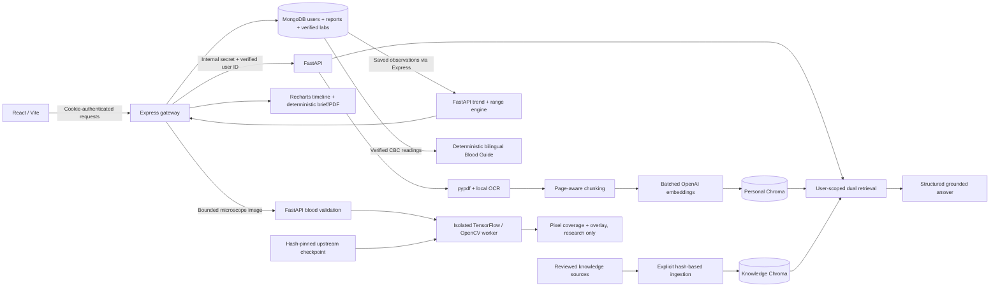

# Architecture

FastAPI uses consistent absolute imports rooted in `ai-service/`. Start Uvicorn there; the hyphenated folder is not treated as a Python import name. Configuration paths resolve from the repository root rather than the shell working directory. Package `__init__.py` files are present for extraction, RAG, LLM, ML, API, routes, and utilities.

Health endpoints do not instantiate the provider client. Chroma collections are loaded lazily and persist between runs. Neither model training nor knowledge embedding runs on startup. Existing folders and upload/chat route paths were preserved; comment-only scaffolding remains available for future features.

Blood Guide's optional checkpoint and model environment live under ignored `.local-data/`. The main AI process never imports TensorFlow or upstream Python source. It verifies known checkpoint hashes and sends a validated image to a bounded local subprocess. Image analysis does not use OpenAI or affect PDF/report storage. Model readiness is independent of core health checks, so the rest of MedGuide remains available without this optional runtime.

MongoDB stores lab rows inside each report document rather than requiring cross-collection transactions. During upload, a processing record is created, FastAPI processes the report, and a ready document is saved. Failed requests remove the file and record and attempt to compensate any vector writes. A process crash during upload can leave a processing record/file; processing reports are excluded from normal lists and should be inspected by an operator before deletion.
